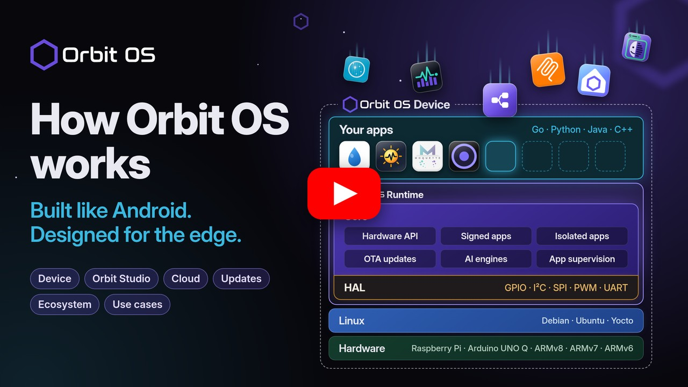
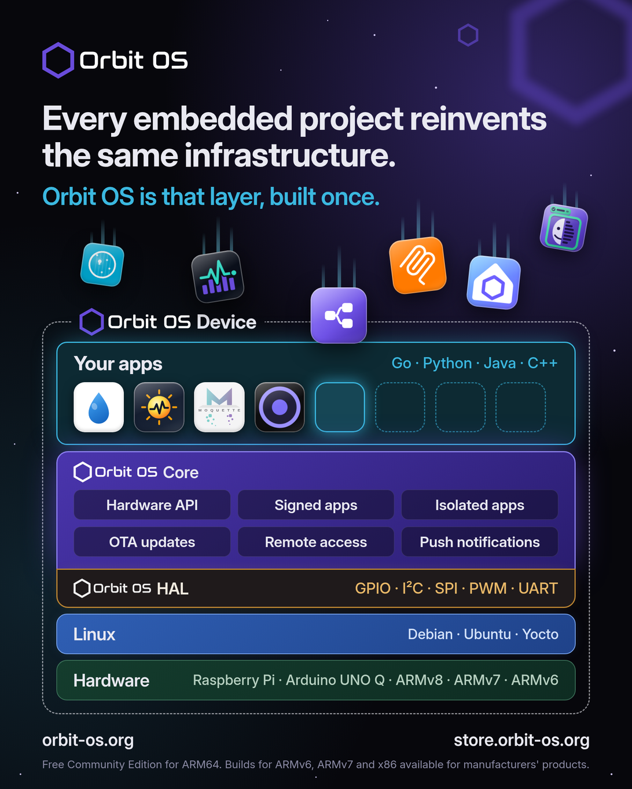
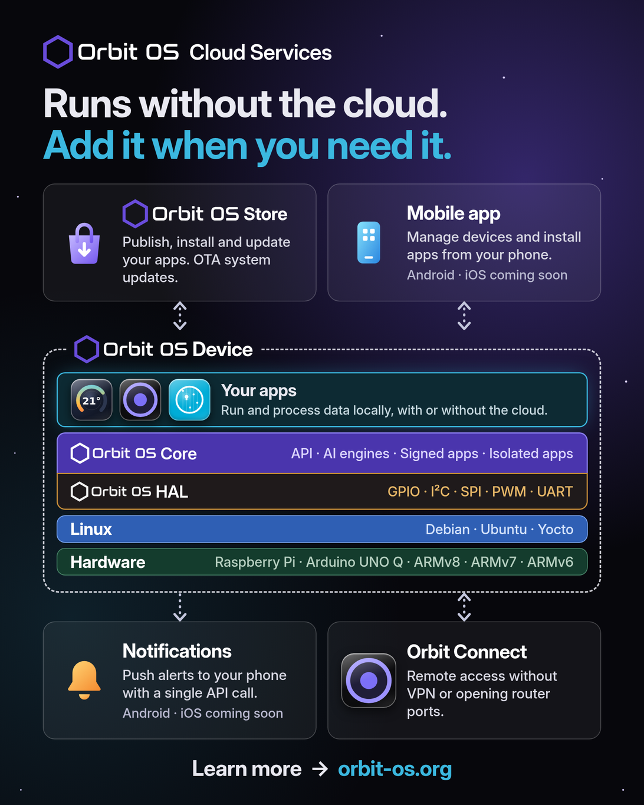
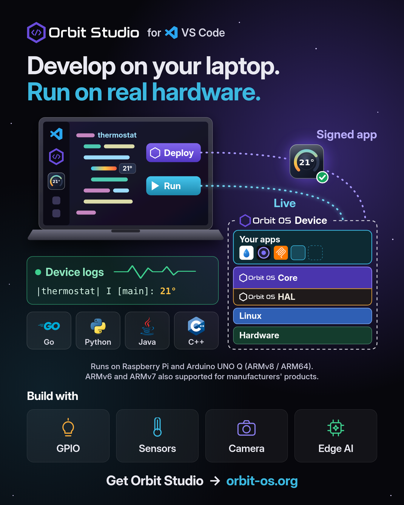
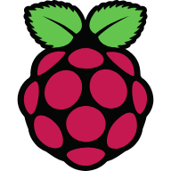

<p align="center">
  
</p>

<h3 align="center">Build your application. Orbit OS handles the platform.</h3>

<p align="center">
An embedded Linux platform for building, deploying, updating and managing connected products —<br>
a native app runtime, signed apps, the Orbit OS Store, atomic OTA updates and one hardware API for Go, Python and Java.
</p>

<p align="center">
  <a href="https://www.orbit-os.org/?ref=github-org"></a>
  <a href="https://www.orbit-os.org/getting_started.html?ref=github-org"></a>
  <a href="https://store.orbit-os.org/?ref=github-org"></a>
  <a href="https://marketplace.visualstudio.com/items?itemName=orbit-os.orbit-studio"></a>
  <a href="https://www.youtube.com/@orbit-os-edge"></a>
</p>

---

## ▶ How Orbit OS works

The whole platform in 11 minutes: the device and its layers, the HAL and the API, Orbit Studio, the Store, updates and real products built on Orbit OS.

<p align="center">
  <a href="https://youtu.be/Z2mgWvDO2rQ"></a>
</p>

## Why Orbit OS

Every embedded Linux product rebuilds the same platform layer: hardware access, app lifecycle, remote deployment, OTA updates, security. Orbit OS ships it ready-made, so you write only the application.

- **Installs on top of your existing Linux** — no reflashing. The native **Orbit OS Runtime** supervises every app — **no Docker**.
- **Real-time development on real hardware** — run your code from your laptop against the device's GPIO, I²C, UART, camera and AI APIs, then ship it as a signed `.orb`.
- **One API for all hardware**, the same in Go, Python and Java, locally or remotely (IPC on the device, a secure mTLS connection from outside).
- **Orbit OS Store, OTA and fleet** — install apps in one click, update apps and the runtime over the air with rollback.
- **Edge AI built in** — TFLite and ONNX runtimes on the device.

## Orbit OS runtime

Your apps run natively on the **[Orbit OS](https://www.orbit-os.org/?ref=github-org) Runtime**, with no Docker: the **Core** runs each signed app in its own sandbox and gives it one API, and the **HAL** connects that API to each board's hardware.

Apps ship as signed `.orb` packages, the equivalent of an APK on Android. Install them locally on the device or from the **[Orbit OS Store](https://store.orbit-os.org/?ref=github-org)**. [Learn more](https://www.orbit-os.org/platform.html?ref=github-org).

<p align="center">
  <a href="https://www.orbit-os.org/platform.html?ref=github-org"></a>
</p>

## Orbit OS Cloud Services

Optional online services: a device runs its apps without them. Add the **[Orbit OS Store](https://store.orbit-os.org/?ref=github-org)**, the mobile app, push notifications or **[Orbit Connect](https://store.orbit-os.org/app/tun?ref=github-org)** when you need them.

To install apps from the Orbit OS Store, [create an Orbit OS Store account](https://www.orbit-os.org/getting_started.html?ref=github-org#gs-store-setup) and link your device to it in Settings. [Learn more](https://www.orbit-os.org/platform.html?ref=github-org).

<p align="center">
  <a href="https://www.orbit-os.org/platform.html?ref=github-org"></a>
</p>

## How it works

| 1 · Install | 2 · Develop | 3 · Ship |
|---|---|---|
| Run the installer on a Raspberry Pi, Arduino UNO Q or other ARM64 board — [guide](https://www.orbit-os.org/getting_started.html?ref=github-org) | Create a project in **[Orbit Studio](https://marketplace.visualstudio.com/items?itemName=orbit-os.orbit-studio)** (VS Code) and run it live against the device | Build a signed `.orb`, deploy it, or publish it on the **[Orbit OS Store](https://store.orbit-os.org/?ref=github-org)** |

## Develop with Orbit Studio

<p align="center">
  <a href="https://marketplace.visualstudio.com/items?itemName=orbit-os.orbit-studio"></a>
  &nbsp;<b>for</b>&nbsp;
  <a href="https://marketplace.visualstudio.com/items?itemName=orbit-os.orbit-studio"></a>
  &nbsp;<b>VS Code</b>
</p>

**[Orbit Studio](https://marketplace.visualstudio.com/items?itemName=orbit-os.orbit-studio)** is the official VS Code extension for Orbit OS, free on the VS Code Marketplace.

- **Run** — your code runs on your computer and talks live to the real device, in Developer Mode.
- **Deploy** — builds your app, signs it as an `.orb` and installs it on the device.
- **Device logs** — stream your app's output to the editor, live.

No flashing between changes, no SSH, no Docker.

<p align="center">
  <a href="https://marketplace.visualstudio.com/items?itemName=orbit-os.orbit-studio"></a>
</p>

## Code example

```go
// UDS on the device, TCP + mTLS from your laptop (Developer Mode) — same API
c, err := client.NewClientAuto("192.168.1.100")
if err != nil {
	log.Fatal(err)
}
defer c.Close()

led := &client.GpioPin{Name: "GPIO17", Number: 17, ChipNumber: 0}
c.GpioManager.SetDirection(led, client.GPIO_DIR_OUT)
c.GpioManager.SetLevel(led, client.GPIO_LEVEL_HIGH)
```

<details>
<summary><b>Python</b></summary>

```python
from client import Client
from client.gpio_manager import GpioPin, GpioDirection, GpioLevel

device = Client.connect("192.168.1.100")
led = GpioPin(name="GPIO17", number=17, chip_number=0)
device.gpio_manager.set_direction(led, GpioDirection.OUT)
device.gpio_manager.set_level(led, GpioLevel.HIGH)
```
</details>

<details>
<summary><b>Java</b></summary>

```java
try (Client client = Client.connect("192.168.1.100", "my-app")) {
    var led = new GpioManager.GpioPin("GPIO17", 17, 0);
    client.gpioManager().setDirection(led, GpioManager.Direction.OUT);
    client.gpioManager().setLevel(led, GpioManager.Level.HIGH);
}
```
</details>

Full reference: **[SDK & API reference (API 26)](https://www.orbit-os.org/api-reference.html?ref=github-org)** · **[PDF manuals](https://github.com/OrbitOS-org/orbit-os-docs)**

## Repositories

**SDKs** — one hardware API, three languages (Apache-2.0)

| Language | Repository | Requires |
|---|---|---|
| **Go** | **[orbit-os-sdk-go](https://github.com/OrbitOS-org/orbit-os-sdk-go)** | Go 1.25+ |
| **Python** | **[orbit-os-sdk-python](https://github.com/OrbitOS-org/orbit-os-sdk-python)** | Python 3.10+ |
| **Java** | **[orbit-os-sdk-java](https://github.com/OrbitOS-org/orbit-os-sdk-java)** | Java 17+ |
| **C++** | *Coming soon — planned for Q4 2026* | — |

**Documentation** — downloadable manuals

| Repository | What it has |
|---|---|
| **[orbit-os-docs](https://github.com/OrbitOS-org/orbit-os-docs)** | SDK API Reference as a printable PDF, one per API version, covering Go, Java and Python |

**Apps** — open-source apps you can install from the Orbit OS Store or build yourself

| App | Repository | What it does | Language | License |
|:---:|---|---|---|---|
| <br><small><b>MCP Server</b></small> | **[orbit-os-app-mcp-server](https://github.com/OrbitOS-org/orbit-os-app-mcp-server)** | Let AI agents (Cursor, Claude Code…) control GPIO, I²C, UART, Wi-Fi and Bluetooth on a real device | Go | Apache-2.0 |
| <br><small><b>Edge AI – Smart Image Detection</b></small> | **[orbit-os-app-smart-image-detection](https://github.com/OrbitOS-org/orbit-os-app-smart-image-detection)** | On-device object detection (YOLOv8, TFLite) on your own images — an example of the Orbit OS AI API | Go | AGPL-3.0 |
| <br><small><b>Edge AI – Face Recognition</b></small> | **[orbit-os-app-face-recognition](https://github.com/OrbitOS-org/orbit-os-app-face-recognition)** | Face detection and recognition from a camera, on the device: enroll a person in seconds and see names live in the browser | Go | Apache-2.0 |
| <br><small><b>IOFlow</b></small> | **[orbit-os-app-ioflow](https://github.com/OrbitOS-org/orbit-os-app-ioflow)** | Test GPIO, PWM, UART, I²C and SPI from your browser: set pins, scan an I²C bus and read or write registers, watch a serial port live | Go | Apache-2.0 |
| <br><small><b>Mochi MQTT Broker</b></small> | **[orbit-os-app-mochi](https://github.com/OrbitOS-org/orbit-os-app-mochi)** | [Mochi MQTT](https://github.com/mochi-mqtt/server) broker with a web admin UI: listeners, MQTT users, topic filters and live messages | Go | Apache-2.0 |
| <br><small><b>Moquette MQTT Broker</b></small> | **[orbit-os-app-moquette](https://github.com/OrbitOS-org/orbit-os-app-moquette)** | [Moquette](https://github.com/moquette-io/moquette) MQTT broker with a web admin UI: start/stop, live clients, configuration and MQTT users | Java | Apache-2.0 |
| <br><small><b>Orbit Flow</b></small> | **[orbit-os-app-orbit-flow](https://github.com/OrbitOS-org/orbit-os-app-orbit-flow)** | Build automation by wiring blocks in your browser, the Node-RED way: Modbus, OPC UA, S7, MQTT, GPIO, PWM and a dashboard for your phone | Go | AGPL-3.0 |
| <br><small><b>Pulse</b></small> | **[orbit-os-app-pulse](https://github.com/OrbitOS-org/orbit-os-app-pulse)** | Device monitor with history: CPU, memory, temperature, disk, network and per-app use as charts in the browser, from the last hour to a year | Python | Apache-2.0 |
| <br><small><b>RPI 4-Channel Relay</b></small> | **[orbit-os-app-rpi-4ch-relay-keyestudio](https://github.com/OrbitOS-org/orbit-os-app-rpi-4ch-relay-keyestudio)** | 4-channel relay controller with web UI, Modbus TCP and MQTT / Home Assistant | Go | Apache-2.0 |
| <br><small><b>Serial Console</b></small> | **[orbit-os-app-serial-console](https://github.com/OrbitOS-org/orbit-os-app-serial-console)** | A serial terminal in your browser: reach a device's UART over the network, with a real terminal emulator | Go | Apache-2.0 |

## Built on Orbit OS

Apps and products made by other teams that run on Orbit OS.

| Project | What it is | Links |
|:---:|---|---|
| <br><small><b><a href="https://www.sprinqua.com/?ref=orbit-os-github">Sprinqua</a></b></small> | Smart irrigation controller for Raspberry Pi relay boards: watering programs, weather-based Smart Watering and Home Assistant over MQTT. Open source (GPL-3.0). | [Website](https://www.sprinqua.com/?ref=orbit-os-github) · [GitHub](https://github.com/Sprinqua) · [Orbit OS Store](https://store.orbit-os.org/app/sprinqua?ref=github-org) |
| <br><small><b><a href="https://www.solastat.com/?ref=orbit-os-github">SolaStat</a></b></small> | Solar monitoring for your home and business. *Coming soon.* | [Website](https://www.solastat.com/?ref=orbit-os-github) |

Built something on Orbit OS? Tell us at info@orbit-os.org or in the [forum](https://forum.orbit-os.org/?ref=github-org) and we'll add it here.

## Capabilities

| Area | Services |
|---|---|
| **Hardware I/O** | GPIO, I²C, SPI, UART, PWM, Camera |
| **Connectivity** | Wi-Fi, Ethernet, Cellular, Bluetooth (BLE), VPN |
| **AI** | TFLite and ONNX model loading and inference |
| **System** | OTA updates, package manager (`.orb`), events, power, metrics, firewall |
| **Apps & users** | AppHub (web UIs behind one login), push notifications to the Orbit OS mobile app |

## Hardware

The **Community Edition** (free for DIY projects) runs on ARM64: the boards below and other ARM64 embedded Linux boards. All the boards below can be used in certified products; **ARMv7 and ARMv6** builds are only for certified products and are not a public download. See the **[Hardware Certification Program](https://www.orbit-os.org/certification.html?ref=github-org)**.

<table>
  <tr><th>Manufacturer</th><th>Board</th><th>Architecture</th><th>Community Edition</th><th>Certified products</th></tr>
  <tr><td rowspan="7" align="center"><br><b>Raspberry Pi</b></td><td>Raspberry Pi 5</td><td>ARM64 (ARMv8)</td><td align="center"></td><td align="center"></td></tr>
  <tr><td>Raspberry Pi 4</td><td>ARM64 (ARMv8)</td><td align="center"></td><td align="center"></td></tr>
  <tr><td>Raspberry Pi 3</td><td>ARM64 (ARMv8)</td><td align="center"></td><td align="center"></td></tr>
  <tr><td>Raspberry Pi Zero 2 W</td><td>ARM64 (ARMv8)</td><td align="center"></td><td align="center"></td></tr>
  <tr><td>Raspberry Pi Zero W</td><td>ARMv6</td><td align="center"></td><td align="center"></td></tr>
  <tr><td>Raspberry Pi Zero</td><td>ARMv6</td><td align="center"></td><td align="center"></td></tr>
  <tr><td>Raspberry Pi 1 A+ / B+</td><td>ARMv6</td><td align="center"></td><td align="center"></td></tr>
  <tr><td rowspan="1" align="center"><br><b>Arduino</b></td><td>Arduino UNO Q</td><td>ARM64 (ARMv8)</td><td align="center"></td><td align="center"></td></tr>
  <tr><td rowspan="1" align="center"><br><b>Luckfox</b></td><td>Luckfox Lyra PLC</td><td>ARMv7</td><td align="center"></td><td align="center"></td></tr>
</table>

## Links

[Website](https://www.orbit-os.org/?ref=github-org) · [Getting started](https://www.orbit-os.org/getting_started.html?ref=github-org) · [Downloads](https://www.orbit-os.org/downloads.html?ref=github-org) · [Docs (PDF)](https://github.com/OrbitOS-org/orbit-os-docs) · [Orbit OS Store](https://store.orbit-os.org/?ref=github-org) · [Forum](https://forum.orbit-os.org/?ref=github-org) · [YouTube](https://www.youtube.com/@orbit-os-edge) · info@orbit-os.org

<sub>The Orbit OS Community Edition is free for DIY projects. The SDKs are open source under Apache-2.0; the apps listed above are open source under the license shown for each one.</sub>

